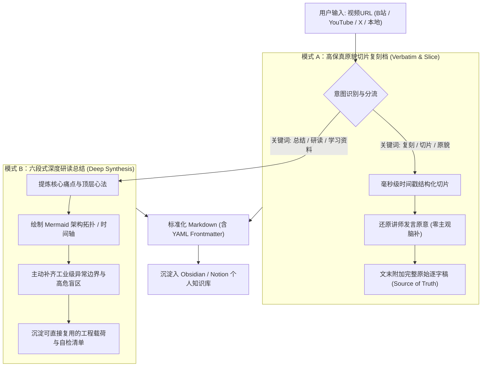

# Video-to-Knowledge (视频学习与高保真知识库沉淀工作流)

<p align="center">
  <b>跨平台视频一键逆向学习与双轨知识库沉淀 Harness 通用 Skill</b><br>
  <i>支持 Bilibili、YouTube、X (Twitter) 与本地音视频：【高保真原貌切片复刻】与【六段式深度研读总结】双模式切换，无缝对接 Obsidian / Notion 知识库</i>
</p>

<p align="center">
  <a href="LICENSE"></a>
  <a href="#-多平台-harness-适配-multi-harness-adaptations"></a>
  <a href="#-支持的数据源"></a>
  <a href="#-obsidian--pkm-知识库原生兼容"></a>
  <a href="plugin.json"></a>
</p>

---

## 📖 核心痛点与方案 (Overview)

在日常技术钻研与自我提升中，我们在 B站、YouTube、X (Twitter) 等平台上经常遇到极具价值的硬核技术视频、讲座或开源研讨：
- **痛点一：传统 AI 总结过于概括、丢失细节**：市面上的省流插件往往只有三五句话，丢失了关键参数、架构演进推导与代码逻辑。
- **痛点二：需要一手事实源进行精准检索**：在构建个人第二大脑（PKM）时，我们需要**没有经过 AI 二次加工的客观时间切片与完整逐字稿附录**，以便后续在 Obsidian 中随时全文检索。
- **痛点三：跨智能体平台（Harness）割裂**：用户可能在 Antigravity、Claude Code、OpenAI Codex、HermesStudio 等不同智能体工作流中学习，缺乏一套统一标准化的视频知识化规范。

**Video-to-Knowledge** 专为解决上述痛点而设计，提供**工业级、通用型、双模式**的视频转知识库解决方案。

---

## ⚡ 双模式处理机制 (Dual-Mode Architecture)



### 1. 模式 A：高保真原貌切片复刻档
* **定位**：个人知识库中**不可篡改的一手事实档案**。
* **特点**：
  * **零主观推演**：不加入 AI 自行脑补的观点，忠实记录讲师所讲事实、真实数据与引用案例。
  * **时间戳切片大纲**：按视频语义节奏切分章节 `[00:00 - 03:15]`。
  * **完整逐字稿附录**：在文档文末保留全部带时间戳的字幕文本，为 Obsidian 全库模糊检索提供支持。
* **模板**：[VERBATIM_SLICE_TEMPLATE.md](skills/video-to-knowledge/references/VERBATIM_SLICE_TEMPLATE.md)

### 2. 模式 B：六段式深度学习资料
* **定位**：面向工程落地的高密度**研读指南与行动载荷**。
* **标准六段式**：
  1. **元数据声明**：解决的核心痛点与适用场景。
  2. **全景概览**：Mermaid 推进图与核心对比表。
  3. **机理拆解**：分模块递进推导底层设计逻辑与架构拓扑。
  4. **高危盲区**：工业级踩坑点与容易忽略的隐性影响（幂等、网络超时、降级）。
  5. **实战载荷**：可直接复制执行的代码片段、YAML 或 JSON 规范。
  6. **准出清单**：可勾选的预检清单 (Pre-flight Checklist)。
* **模板**：[SIX_SECTION_TEMPLATE.md](skills/video-to-knowledge/references/SIX_SECTION_TEMPLATE.md)
* **生产级旗舰标杆案例**：[examples/stanford_cs146s_always_on_agents_distillation.md](examples/stanford_cs146s_always_on_agents_distillation.md)
  * 原视频出处：Stanford CS146S（Lee Robinson，时长 45分17秒）。
  * 深度沉淀：42 张高清幻灯片语义对照、Mermaid 脉络时间轴、Firecracker MicroVM 状态机、Temporal 持久化容灾、Prompt 缓存无损架构、高危盲区表与 Pre-flight 检查清单。

---

## 🛠️ 多平台 Harness 适配 (Multi-Harness Adaptations)

本项目遵循开放技能规范，原生适配当前主流 Agent Harness：

| Harness 平台 | 适配文件 | 加载方式 |
| :--- | :--- | :--- |
| **Google Antigravity** | [adapters/antigravity/ANTIGRAVITY.md](adapters/antigravity/ANTIGRAVITY.md) | 注册为全局 Skill 或项目工作区 Skill，由 `plugin.json` 自动引导。 |
| **Anthropic Claude Code** | [adapters/claude/CLAUDE.md](adapters/claude/CLAUDE.md) | 注入项目根目录 `CLAUDE.md`，支持终端命令与长上下文提取。 |
| **OpenAI Codex / ChatGPT** | [adapters/codex/CODEX.md](adapters/codex/CODEX.md) | 作为 System Instructions 载入，配合 Code Interpreter 执行切片脚本。 |
| **Hermes / HermesStudio** | [adapters/hermes/hermes_role.md](adapters/hermes/hermes_role.md) | 注册为 `VideoKnowledgeSynthesizer` 战队角色与原子 Tool。 |

---

## 📚 Obsidian / PKM 知识库原生兼容

每篇输出文档顶部均预置标准的 **YAML Frontmatter**：

```yaml
---
title: "深入理解分布式事务与最终一致性"
source_url: "https://www.bilibili.com/video/BV1xxxxxx"
platform: "Bilibili"
author: "技术架构师-老张"
duration: "28:45"
date: 2026-10-12
type: "video-verbatim-slice" # 或 "video-deep-synthesis"
tags:
  - 学习笔记/分布式
  - 视频切片
status: "已归档"
---
```

在 Obsidian 中配合 **Dataview** 插件，即可一键生成全局视频看板：
````markdown
```dataview
TABLE author AS "讲师/UP主", platform AS "平台", duration AS "时长", type AS "模式", date AS "归档日期"
FROM #视频切片 OR #学习笔记/深度研读
SORT date DESC
```
````

---

## 🚀 极速上手 (Quick Start)

### 1. 启动可视化视频分析网站 (Video2Knowledge Web Studio)
本项目内置完整的现代化 Web 可视化分析工作台（基于 React 18 + Tailwind CSS + Mermaid.js + Express）：

- **一键极速启动**：在项目根目录下双击执行 `start_web.bat`（或在终端运行 `cd web && npm start`）。
- **浏览器访问**：打开 [http://localhost:3001](http://localhost:3001)。
- **核心交互亮点**：
  - 🎥 **全源覆盖**：支持 B站 (BV号/链接免登录提取)、YouTube、X(Twitter) 演讲推文与本地字幕/文稿。
  - 🔄 **双模无缝切换**：实时生成并对照【模式 B：六段式深度研读】与【模式 A：高保真原貌切片复刻】。
  - 🖼️ **原画幻灯片对照画廊**：内置斯坦福 CS146S 42 张原画幻灯片，点击时间戳即刻精准定位。
  - 📊 **动态 Mermaid 拓扑**：时间轴脉络图、核心时序交互图原生高保真渲染。
  - 💾 **Obsidian PKM 与桌面同步**：一键复制带 YAML Frontmatter 的标准笔记，或一键同步至桌面个人知识库。

### 2. 抓取 B 站视频字幕与元数据 (内置脚本)
本工具箱内置开箱即用的轻量提取脚本（纯标准库实现，无重型第三方依赖）：

```bash
# 获取 Markdown 格式的文稿与切片
python skills/video-to-knowledge/scripts/bilibili_extractor.py "https://www.bilibili.com/video/BV1xx411c7mD"

# 或导出为结构化 JSON
python skills/video-to-knowledge/scripts/bilibili_extractor.py "BV1xx411c7mD" --json
```

### 3. 自然语言零门槛触发 (Natural Language Zero-Prompt Triggers)
告别死记硬背的前缀指令！在任何支持的 Agent 对话框中，直接使用你最习惯的日常口语交流即可触发：

* **场景 1：想要一手事实与字轨切片（原貌复刻）**
  > “帮我把这个视频切片一下，原话不要改动：https://www.bilibili.com/video/BV1xxxxxx”  
  > “提取推文里这个演讲的完整逐字稿，带上时间戳：https://x.com/...”
* **场景 2：想要干货提炼与架构拓扑（深度研读）**
  > “这个视频讲了什么核心干货？总结成六段式深度研读笔记：https://youtube.com/watch?v=xxx”  
  > “拆解一下这个视频的系统架构设计，有哪些高危踩坑点？画个时序图”
* **场景 3：快速分享与日常随手丢链接（智能融合模式）**
  > “看看这个视频：https://b23.tv/xxx”  
  > *(Agent 将自动采用智能融合呈现：正文输出六段式高密度研读，文末以折叠框附带一手时间戳字轨与完整逐字稿)*

---

## 📂 项目目录结构 (Directory Structure)

```text
video-to-knowledge/
├── .github/
│   └── workflows/ci.yml         # GitHub Actions 自动化校验
├── adapters/                    # 主流 Harness 适配层
│   ├── antigravity/             # Antigravity 适配规范
│   ├── claude/                  # Claude Code 适配规范
│   ├── codex/                   # OpenAI Codex 适配规范
│   └── hermes/                  # HermesStudio 角色与 Tool 契约
├── skills/
│   └── video-to-knowledge/
│       ├── SKILL.md             # 核心通用技能规范定义
│       ├── references/          # 权威标准模板与 PKM 规范
│       │   ├── OBSIDIAN_PKM_SPEC.md
│       │   ├── SIX_SECTION_TEMPLATE.md
│       │   └── VERBATIM_SLICE_TEMPLATE.md
│       └── scripts/             # 开箱即用提取工具
│           ├── bilibili_extractor.py
├── web/                         # 可视化分析工作台 (React 18 + Tailwind + Express)
│   ├── server/                  # 接口后端与提取/同步联动
│   ├── src/                     # React 前端组件与沉浸式阅览器
│   └── package.json             # Web 工程依赖
├── examples/                    # 完整真实交付物示范
│   ├── images/                  # 真实标杆案例配套高清原画资产 (42张)
│   ├── sample_mode_a_verbatim.md
│   ├── sample_mode_b_distillation.md
│   └── stanford_cs146s_always_on_agents_distillation.md # 生产级模式 B 旗舰标杆案例
├── plugin.json                  # Antigravity 插件配置
├── pyproject.toml               # Python 项目配置
├── start_web.bat                # Windows 一键启动网站脚本
├── LICENSE                      # MIT 开源许可证
└── README.md                    # 项目全景说明
```

---

## 📄 开源许可证 (License)

本项目基于 [MIT License](LICENSE) 开源。欢迎 Star、Fork 并贡献针对更多视频源（YouTube, X, 播客）的提取适配器！
