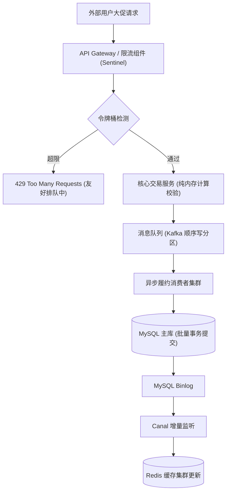

# 深度研读案：高并发架构设计的本质心法与防坑实战

> **视频来源**：[资深系统架构师 - 高并发高可用系统演进核心逻辑](https://www.bilibili.com/video/BV1xx411c7mD)  
> **核心痛点**：流量突增场景下，传统单体系统盲目横向扩容导致数据库雪崩、事务超时死锁的工业级破局方案。  
> **知识密度**：★★★★★ | **建议阅读时间**：8 分钟

---

## 目录
1. [视频核心概述与全景时间轴](#1-视频核心概述与全景时间轴)
2. [为什么需要该演进方案？（背景与本质动机）](#2-为什么需要该演进方案背景与本质动机)
3. [核心机理与架构全景拆解](#3-核心机理与架构全景拆解)
4. [工业级高危盲区与反模式（必避坑点）](#4-工业级高危盲区与反模式必避坑点)
5. [实战落地工程载荷（配置与方案）](#5-实战落地工程载荷配置与方案)
6. [准出自检清单 (Pre-flight Checklist)](#6-准出自检清单-pre-flight-checklist)

---

## 1. 视频核心概述与全景时间轴

```mermaid
timeline
    title 高并发架构演进关键时间节点
    00:00 : 痛点暴露 : 流量激增下的单库连接池雪崩
    04:13 : 异步解耦 : 核心交易与非核心履约的消息分流
    10:31 : 缓存一致 : Canal 监听 binlog 异步更新缓存
    15:51 : 准则收敛 : 指标先行、渐进演进、拒绝过度设计
```

| 时间点 | 章节主题 | 核心心法 / 技术要点 |
| :--- | :--- | :--- |
| **00:00** | **单体瓶颈** | 横向扩容不能解决底层单库行锁竞争，瓶颈在 DB I/O |
| **04:13** | **异步削峰** | 强制执行“先入队后结算”，以时间换取系统生存空间 |
| **10:31** | **缓存一致** | 避免双写污染，采用延迟双删或 binlog 异步增量订正 |
| **15:51** | **生产心法** | “任何没有监控度量支撑的架构优化，都是技术虚荣” |

---

## 2. 为什么需要该演进方案？（背景与本质动机）

1. **资源不对称性**：无状态计算资源（Web 节点）极易横向扩缩容，但有状态存储资源（关系数据库）存在物理写瓶颈。
2. **死锁放大效应**：当并发线程数超过数据库 CPU 核心数的 2~3 倍时，上下文切换开销将吞噬有效吞吐量。

---

## 3. 核心机理与架构全景拆解



---

## 4. 工业级高危盲区与反模式（必避坑点）

> [!WARNING]
> 针对讲师提到的方案，在工业级落地时必须警惕以下三处隐性陷阱：

1. **盲区一：MQ 消息乱序导致状态倒退**
   - *风险*：用户先点击“取消订单”后点击“支付”，若消息乱序可能导致已取消订单被扣费。
   - *对策*：在 Kafka 中以 `order_id` 为 Partition Key，强制保证同一订单的所有事件在同一分区串行消费。
2. **盲区二：缓存穿透与击穿防御不足**
   - *风险*：爆款商品过期瞬间，数万请求直打 DB。
   - *对策*：对热点 Key 开启逻辑过期时间（后台异步刷新）或互斥锁加载。

---

## 5. 实战落地工程载荷（配置与方案）

```yaml
# 核心限流降级配置
sentinel:
  flow_rules:
    - resource: "/api/order/create"
      grade: 1 # QPS 模式
      count: 2000
      control_behavior: 2 # 排队等待 (Rate Limiter)
      max_queueing_time_ms: 500
```

---

## 6. 准出自检清单 (Pre-flight Checklist)

- [ ] **限流门禁**：核心写接口是否已配置合理的 Sentinel/Redis 令牌桶限流？
- [ ] **幂等保证**：消费者端是否以全局唯一订单号作为分布式幂等去重键？
- [ ] **容灾演练**：是否已在预发环境进行过压测验证连接池断开恢复能力？
