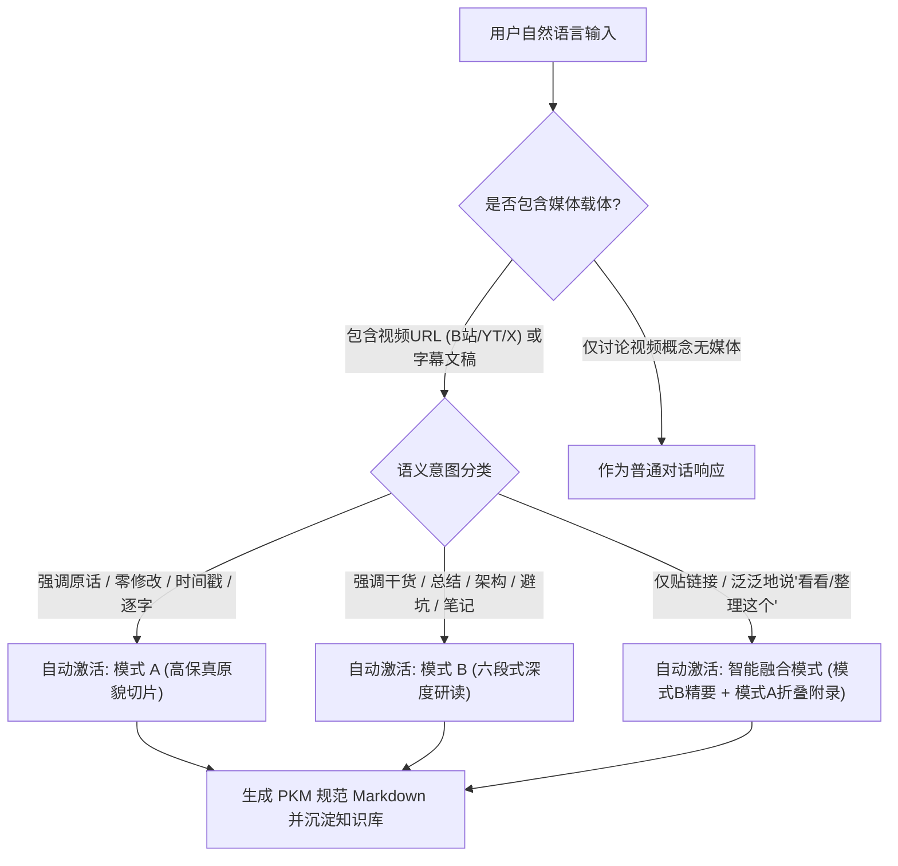

# 自然语言触发与语义路由规约 (Natural Language Trigger & Semantic Routing Spec)

本规约旨在消除人机交互中的“指令记忆负担”，使 Agent 能够像经验丰富的研发助手一样，通过**日常自然对话**精准识别用户的视频学习意图，并自动流转至对应的工程化交付模式。

---

## 1. 触发判定管道 (Trigger Pipeline)

---

## 2. 意图分类语义基准与自然语言语料库 (Corpus & Benchmarks)

### 类别一：原貌切片复刻意图 (Fidelity & Slicing) -> 路由至模式 A
* **核心特征**：用户需要**一手事实、客观记录、无主观篡改、时间轴切片、原文字幕**。
* **高频语义词**：`切片`、`原貌`、`原话`、`逐字`、`字轨`、`不要二次加工`、`别自己脑补`、`客观记录`、`还原讲稿`、`详细时间戳`。
* **典型用户自然语言输入示例**：
  1. *“帮我把这个视频切片一下，原话不要改动：https://b23.tv/xxx”*
  2. *“把这个 B 站视频还原成文稿，带上每个章节的时间戳。”*
  3. *“提取这个视频的字幕，分段整理好存进我的知识库，不要 AI 概括。”*
  4. *“这个推文里的演讲很硬核，客观复刻一份，文末附上完整逐字稿。”*
  5. *“这个采访做个纯详细切片文档，原汁原味记录。”*

### 类别二：深度研读提炼意图 (Distillation & Synthesis) -> 路由至模式 B
* **核心特征**：用户需要**提炼心法、吸收知识、画架构图、查找反模式与踩坑点、生成 Checklist**。
* **高频语义词**：`总结`、`研读`、`提炼`、`干货`、`核心要点`、`拆解架构`、`怎么设计的`、`画个流程图`、`避坑指南`、`做成学习资料`、`沉淀到Obsidian`。
* **典型用户自然语言输入示例**：
  1. *“这个视频讲了什么核心干货？总结一下：https://youtube.com/watch?v=xxx”*
  2. *“帮我拆解一下这个视频里的系统设计架构，画个 Mermaid 图。”*
  3. *“这个教程讲得挺深，帮我提炼成六段式深度学习研读案。”*
  4. *“太长不看了，帮我把这个 40 分钟技术分享浓缩成笔记，标出高危盲区。”*
  5. *“有哪些工业级踩坑点？总结下讲师的心法和落地自检清单。”*

### 类别三：模糊与缺省意图 (Smart Adaptive Hybrid) -> 路由至智能融合模式
* **核心特征**：用户只发了链接，或用极简短语，如“看看这个”。
* **典型输入示例**：
  1. *“https://www.bilibili.com/video/BV1xx411c7mD”*
  2. *“看看这个视频：https://x.com/user/status/123456”*
  3. *“帮我整理这个视频”*
  4. *“学一下这个视频的内容”*
* **智能自适应处理策略**：
  * **主干部分**：输出模式 B 六段式深度研读（痛点、时间轴、机理拓扑、盲区、自检清单），提供最高的信息密度；
  * **尾部附录**：通过折叠块（`

展开原始时间戳切片与完整逐字稿附录
...
`）无缝嵌入模式 A 内容；
  * **收益**：一步到位，兼顾人类高效阅读与知识库全文检索需求。

---

## 3. 知识库参数的自然语言提取 (Entity Extraction)

当用户在自然语言中提及知识库细节时，Agent 自动提取实体并注入 YAML Frontmatter：

| 自然语言提及 | 提取实体 | YAML Frontmatter 对应字段 |
| :--- | :--- | :--- |
| *“标签加上分布式和架构”* | `tags: [学习笔记/分布式, 架构设计]` | `tags` |
| *“分类放到后端开发”* | `category: "后端开发"` | `category` |
| *“存到我的考研网课库”* | `vault_path: "考研网课/"` | 输出目录路由 |
| *“作者是叫张三的架构师”* | `author: "张三"` | `author` (覆盖默认检测) |
