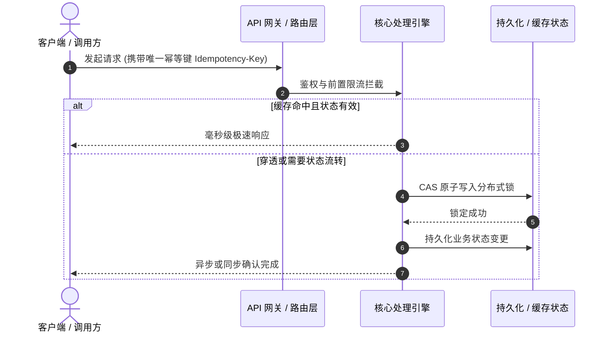

# 模式 B：六段式深度学习资料标准模板 (Six-Section Distillation Template)

> **核心原则**：去粗取精、直击本质、补齐盲区、面向落地。摒弃口语化废话，提炼心法，补全讲师未提及的工业级异常边界与工程载荷。

---

```markdown
---
title: "{视频核心主题深度研读案}"
source_url: "{视频源URL}"
platform: "{Bilibili | YouTube | X | 本地视频}"
author: "{讲师/UP主/博主名称}"
duration: "{MM:SS 或 HH:MM:SS}"
date: {YYYY-MM-DD}
type: "video-deep-synthesis"
tags:
  - 学习笔记/深度研读
  - 架构设计
  - {领域分类标签}
status: "已归档"
---

# 深度研读案：{视频核心主题与关键要义}

> **视频来源**：[{讲师名称} - {原视频标题}]({视频源URL})  
> **核心痛点**：{一句话讲清该视频解决的工业界真实痛点或技术瓶颈}  
> **知识密度**：★★★★★ | **建议阅读时间**：10 分钟

---

## 目录
1. [视频核心概述与全景时间轴](#1-视频核心概述与全景时间轴)
2. [为什么需要该方案？（背景与本质动机）](#2-为什么需要该方案背景与本质动机)
3. [核心机理与架构全景拆解](#3-核心机理与架构全景拆解)
4. [工业级高危盲区与反模式（必避坑点）](#4-工业级高危盲区与反模式必避坑点)
5. [实战落地工程载荷（模板/配置/协议）](#5-实战落地工程载荷模板配置协议)
6. [准出自检清单 (Pre-flight Checklist)](#6-准出自检清单-pre-flight-checklist)

---

## 1. 视频核心概述与全景时间轴

```mermaid
timeline
    title 核心逻辑推进脉络
    00:00 : 痛点引入 : 揭示行业普遍存在的性能与架构瓶颈
    05:20 : 方案对比 : 传统单体/轮询机制的失效原因
    12:40 : 核心设计 : 状态机与事件总线的异步解耦
    20:15 : 工业踩坑 : 网络抖动、幂等重试与脑裂防范
    28:00 : 生产落地 : 灰度发布、监控指标与 SOP
```

| 时间点 | 章节主题 | 核心心法 / 技术要点 |
| :--- | :--- | :--- |
| **00:00** | **痛点引入** | 揭示业务激增时的雪崩效应与传统思路局限 |
| **05:20** | **方案选型** | 横向对比方案 A vs 方案 B 的权衡取舍 (Trade-offs) |
| **12:40** | **核心机理** | 核心状态机运转与数据流转时序 |
| **20:15** | **高危边界** | 工业级异常防御：并发竞争、幂等与一致性 |
| **28:00** | **演进落地** | 从 0 到 1 的生产环境实施路径与监控基准 |

---

## 2. 为什么需要该方案？（背景与本质动机）

不谈具体语法，直击设计哲学与工程动机：
1. **真实世界约束**：并发激增、网络不可靠、内存与计算成本高昂。
2. **为什么传统方案失效？**：详细阐述过去流行解法的阿喀琉斯之踵。
3. **架构演进必然性**：从命令式到声明式、从同步阻塞到事件驱动的演化逻辑。

---

## 3. 核心机理与架构全景拆解

### 3.1 系统拓扑与数据流转时序



### 3.2 关键组件技术细节
- **模块 A（Ingestion Layer）**：……
- **模块 B（State Machine）**：……

---

## 4. 工业级高危盲区与反模式（必避坑点）

> [!WARNING]
> 本节补充视频内容可能略过或未深入展开的工业级边界坑点，避免直接照搬代码导致线上事故。

1. **盲区一：幂等性缺失与幽灵重试**
   - *现象*：上游网络超时重试导致下游重复入账或重复执行。
   - *防范*：必须强制绑定分布式全局唯一 Request ID + Redis SETNX 状态门禁。
2. **盲区二：内部管理后台与运营客服 SOP 联动脱节**
   - *现象*：C 端引入新机制，但客服后台无法查询该状态，导致客诉时无据可查。
3. **盲区三：下游第三方服务降级容灾熔断**
   - *现象*：依赖的第三方接口挂掉直接拖垮核心主链路。

---

## 5. 实战落地工程载荷（模板/配置/协议）

可直接复制的工程落地代码、YAML 或 JSON 规范：

```yaml
# 核心业务编排配置示例
service:
  name: "knowledge-engine"
  timeout_ms: 3000
  retry:
    max_attempts: 3
    backoff_strategy: "exponential"
  circuit_breaker:
    error_threshold_percentage: 50
    sleep_window_ms: 10000
```

---

## 6. 准出自检清单 (Pre-flight Checklist)

- [ ] **业务对齐**：是否明确定义核心度量指标与业务目标？
- [ ] **异常覆盖**：是否完整覆盖断网、超时、并发竞争等异常分支？
- [ ] **幂等保证**：关键写入操作是否具备分布式幂等保证？
- [ ] **监控告警**：是否配置了核心链路的延迟、错误率 Dashboard 看板？
- [ ] **回滚预案**：发生不可逆严重缺陷时，是否有 5 分钟内生效的降级回滚开关？
```
